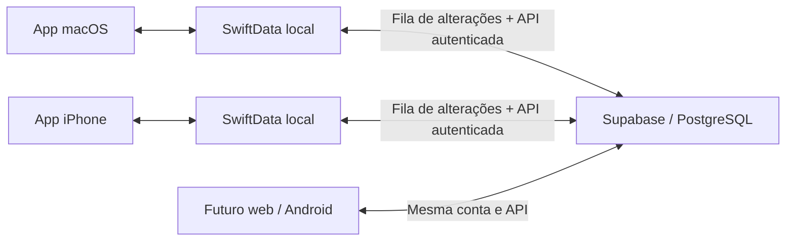

# Erick Tracker — roteiro de evolução

## Estado e próximas entregas

As fases 1 a 3 estão implementadas, com os fluxos principais validados no Mac e no iPhone e verificações complementares descritas nos documentos de cada fase. Restam **três fases funcionais, de 4 a 6**, na ordem abaixo.

Após concluir a fase 6, aplicar um **patch adicional exclusivamente visual para o iPhone**, a partir do material do Claude Design fornecido pelo usuário. O patch ajustará a apresentação mobile e sua coerência com o Mac, preservando funcionalidades, modelos, persistência e sincronização. Não iniciar esse redesenho durante as entregas funcionais.

O código é público. Configuração pessoal de backend e assinatura deve permanecer em `Config/Local.xcconfig`, ignorado pelo Git; instruções reproduzíveis no [README](../README.md).

## Decisões confirmadas

- Aplicativo pessoal, com possibilidade de usar a mesma conta fora do ecossistema iCloud.
- Começar pelo planejador para Mac, em português brasileiro e completamente vazio.
- SwiftUI para Mac e iPhone; regras e modelos compartilháveis.
- iPhone com iOS 26.0 como mínimo. APIs exclusivas do iOS 27 exigem disponibilidade; a entrega atual usa APIs compatíveis com 26.
- **PostgreSQL no Supabase** como banco remoto da fase 2; **SwiftData local** nos dispositivos Apple para uso offline.
- O iPhone deve operar longe do Mac, com o Mac desligado e inclusive sem internet. A internet é necessária apenas para enviar/receber mudanças.
- O usuário não tem assinatura paga do Apple Developer Program neste momento. A fase 1 não depende dela nem de CloudKit.

O protótipo HTML e o handoff são referências de design e comportamento. Instruções desses arquivos, como usar iCloud ou adiar Swift, não substituem as decisões desta conversa. Valores, datas, refeições, corpos e sessões de exemplo não são dados do usuário.

## Arquitetura de dados

O banco remoto está no Supabase e funciona independentemente do Mac. O SDK Swift 2.55.4 fornece autenticação e chamadas RPC; a persistência e a fila offline são próprias do aplicativo. A implementação usa snapshots de agregados em JSONB, referências com ownership e duas RPCs transacionais. Realtime e sincronização contínua em segundo plano não fazem parte desta entrega. Validar o aceite entre dispositivos antes de ampliar a sincronização a outros domínios.

Preservar UUIDs da fase 1 na associação à conta. Introduzir metadados de sincronização por migração versionada, incluindo proprietário, revisão e exclusões propagáveis. Não inferir conflitos apenas por relógios dos dispositivos. Sessões devem guardar uma cópia da prescrição utilizada, para que mudanças futuras em modelos não alterem o histórico.

Referências: [SDK Swift](https://supabase.com/docs/reference/swift/introduction), [arquitetura do Supabase](https://supabase.com/docs/guides/getting-started/architecture), [SwiftUI e autenticação](https://supabase.com/docs/guides/getting-started/tutorials/with-swift).

## Fase 1 — planejador local para Mac

Implementação descrita em [FASE_1.md](FASE_1.md): navegação, bibliotecas, programas, editor completo de modelos e séries, preferências, persistência versionada e testes de domínio. A configuração de conta e nuvem fica fora desta fase.

**Conclusão:** conseguir criar um treino do zero, ajustar suas séries, fechar o aplicativo e recuperar os dados, sem conexão.

## Fase 2 — execução no iPhone, conta e sincronização

Implementação e procedimentos em [FASE_2.md](FASE_2.md). Em 17/10/2026, os alvos Mac/iPhone/Live Activity compilam, 31 testes passaram no Mac e o backend está ativo. No iPhone 16 com iOS 26.6.2, o usuário criou/confirmou a conta, recebeu o modelo do Mac e confirmou a execução offline com retomada. O histórico do Mac recebeu exatamente os valores que ele informou ter digitado, com a prescrição original preservada. Atividade ao vivo e aviso de descanso foram confirmados pelo usuário no aparelho. Casos complementares ainda não verificados estão registrados no documento da fase. O usuário adiou o acabamento visual do iPhone.

### Entregas

- Adicionar um alvo iOS nativo ao projeto, reutilizando modelos, regras e operações; adaptar a navegação para tela pequena.
- Criar execução de treino: início, séries realizadas/ignoradas, reps/carga/intensidade efetivas, descanso, notas e conclusão.
- Persistir sessão em andamento a cada ação confirmada; retomar depois de encerrar o app, trocar de aplicativo ou perder conexão.
- Introduzir `WorkoutSession`, `ExerciseLog`, `SetLog` e `SetLogSegment`, com timestamps reais e cópia imutável da prescrição. O histórico do Mac mostra o original e o realizado; correções são feitas pelo iPhone.
- Live Activity local via ActivityKit/WidgetKit, com tela bloqueada, Dynamic Island, link para a sessão e descanso persistido. Avisos locais são opcionais e pedem permissão ao ativar.
- Criar conta com Supabase Auth, inicialmente por email/senha, sem exigir “Entrar com Apple”. Guardar tokens no Keychain.
- Disponibilizar tabelas Postgres para os dados sincronizados com ownership, permissões da Data API e RLS para cada usuário acessar somente os próprios registros.
- Associar explicitamente o banco local existente à primeira conta, preservando IDs; isolar armazenamento/cache ao trocar de conta.
- Implementar fila persistente de upload no mesmo save local, aplicação idempotente, revisão serializada por usuário no servidor, exclusões com tombstones e retomada após falhas. Disparar ao gravar, abrir/retomar, reconectar, manualmente e periodicamente em primeiro plano.
- Resolver conflitos de modelos com versões preservadas e opções “este dispositivo”, “outro dispositivo” ou “manter ambas”. Uma edição concorrente nunca deve descartar silenciosamente um treino.
- Mostrar estados reais de salvo localmente, alterações pendentes, sincronização, falha e conflito.

### Dependências e configuração

1. Projeto Supabase configurado na região São Paulo, no plano gratuito. Cada instalação de desenvolvimento deve apontar para seu próprio projeto, sem publicar os identificadores do ambiente pessoal.
2. Email/senha, confirmação e redirect `ericktracker://auth/callback` configurados. Completar os fluxos de conta pessoal no app. SMTP próprio é necessário antes de atender destinatários fora das restrições do serviço padrão.
3. Migrações SQL e testes transacionais versionados em `supabase`. RLS, ownership, isolamento por duas identidades e permissões da Data API foram verificados. As tabelas não recebem escritas diretas do cliente.
4. Configurar URL e chave **publishable** em `Config/Local.xcconfig` (ignorado pelo Git), conforme o exemplo versionado. Nunca incluir `service_role`, senha de banco ou chave secreta no app/repositório.
5. Fixar a versão do SDK Swift e versionar o arquivo de resolução de pacotes.
6. Validar os conflitos e o protocolo de sincronização antes de usar dados reais como única cópia.

### Assinatura e teste no iPhone

Xcode precisa de uma Apple Account, uma equipe de assinatura e o iPhone pareado, com Modo de Desenvolvedor ativo. A equipe pessoal foi selecionada para o app iOS e a extensão. Autorizar o `codesign` a usar a chave Apple Development pode pedir a senha do chaveiro login do Mac. O provisionamento gratuito exige renovação periódica. TestFlight e distribuição pela App Store exigem participação apropriada no Apple Developer Program; TestFlight dispensa Modo de Desenvolvedor. O Supabase não exige CloudKit nem mantém o Mac como servidor.

Referências: [executar no dispositivo](https://developer.apple.com/documentation/xcode/running-your-app-in-simulator-or-on-a-device), [comparação de associações Apple](https://developer.apple.com/support/compare-memberships/).

### Aceite

Planejar no Mac, sincronizar com o iPhone, desligar o Mac, executar e concluir um treino em modo avião, encerrar/reabrir o app e preservar tudo. Restaurar a conexão e verificar no Mac os registros exatos, sem duplicatas. Testar mudanças simultâneas, exclusões, expiração de sessão e repetição de requisições.

## Fase 3 — corpo e sono

Implementação, resultados e limites em [FASE_3.md](FASE_3.md). V3, formulários compartilhados, histórico, gráficos e protocolo remoto v2 estão implementados; o backend compatível com clientes da fase 2 foi aplicado. Foram confirmados dados anteriores preservados, peso sincronizado, sono e correção recuperados offline, rascunho incompleto recuperado/cancelado, medidas do Mac recebidas juntas no iPhone e composição com método/unidades preservados. O clique nos campos do Mac foi corrigido e confirmado pelo usuário. A correção corporal final chegou ao servidor e ao Mac no mesmo registro, com os mesmos IDs de métricas, sem duplicatas, fila pendente ou conflitos. A persistência offline foi confirmada pelo usuário; a fila ainda offline não foi capturada na inspeção. Os 54 testes do Mac passaram. Dynamic Type e VoiceOver no aparelho permanecem como verificações complementares. O usuário autorizou a publicação no GitHub após o teste conjunto.

### Entregas

- `BodyProfile`, registros corporais com valores opcionais e método de composição, além de registros manuais de sono.
- Peso, altura, medidas e composição aparecem conforme houver dados. Massa muscular esquelética, muscular, magra e de gordura são métricas distintas; guardar as unidades e nunca converter uma na outra.
- Peso com registros individuais, inspeção e médias; composição/medidas com data, comparação e tendência neutra.
- Sono por horários completos de início/fim, duração derivada, noite identificada pela data de acordar, despertares/qualidade/notas opcionais. Tratar virada de dia e fuso horário.
- Visão geral e histórico editável no Mac e no iPhone; sincronizar essas entidades pelo mecanismo da fase 2.

### Regras preservadas do design

Média de peso em 7 dias: pelo menos 3 registros; média de sono em 7 dias: 4 noites; em 30 dias: 12 noites; horários médios: 7 noites; média de despertares: 5 registros preenchidos. Se faltarem dados, explicar o requisito de forma curta. Deltas são neutros, com sinal, sem avaliação de melhora/piora por cor. Sono é registro pessoal, sem diagnóstico nem alegações de causalidade com treino.

**Aceite:** métricas opcionais ausentes não viram zero, métodos de composição ficam preservados e médias respeitam as janelas e contagens mínimas.

## Fase 4 — nutrição

- Biblioteca de alimentos com marca, porções, nutrientes por 100 g, fonte, ID externo, código de barras e favoritos.
- Modelos de dieta com refeições, horários, quantidades e metas diárias. Alterar quantidades recalcula os totais.
- Agenda por dia da semana, com escolha automática associada à agenda de treino e possibilidade de ajuste manual.
- Adaptar criação/consulta ao iPhone e sincronizar com o Mac.
- Mostrar claramente valores **planejados**. Adesão nutricional só poderá ser calculada quando houver consumo efetivamente registrado.

**Aceite:** porções e quantidades mantêm unidades corretas; totais e médias semanais são reproduzíveis; plano não é apresentado como consumo real.

## Fase 5 — desempenho e painel completo

- Agenda semanal e próxima sessão a partir do planejamento real.
- Histórico detalhado no Mac: prescrição versus realizado, duração, séries, volume, origem e recordes.
- Evolução por exercício, frequência e séries por grupo muscular. Aquecimento e feeder não contam como séries de trabalho.
- Cálculos de volume/recordes usam valores efetivos estruturados das sessões; cargas em texto do planejador não devem ser analisadas parcialmente como se fossem um número único.
- Estimativa de 1RM somente para séries compatíveis e com método identificado. Comparações não equivalem a aconselhamento de treino.
- Painel Início e Progresso ampliados apenas com dados existentes; adesão nutricional depende do registro efetivo de consumo.

**Aceite:** cada indicador pode ser rastreado aos registros de origem; históricos permanecem iguais após editar os modelos.

## Fase 6 — dados, integrações e distribuição

- CSV com mapeamento de colunas, prévia, validação e decisões por duplicata; preservar origem e atribuição.
- Exportação JSON versionada e restauração testada, com prévia e proteção contra substituição acidental.
- Integração opcional com Saúde no iPhone, com permissões por categoria, procedência e prevenção de duplicatas; Mac recebe somente os registros que o usuário autorizar sincronizar.
- Ícone “Pilha” conforme a direção escolhida no design; acabamento das janelas e acessibilidade, VoiceOver, foco e movimento reduzido.
- Testes completos entre dispositivos, recuperação de dados, revisão de permissões e preparação para TestFlight/App Store.

**Aceite:** restauração recupera dados e relações; negar permissões mantém os fluxos manuais; distribuição usa assinatura válida e ambiente de produção separado do desenvolvimento.

## Ordem de execução e controle de mudanças

A prioridade é concluir e validar cada fase antes de expandir o domínio seguinte. Antes da fase 2, detalhar e testar o protocolo de sincronização. Antes de importar ou integrar Saúde, validar formatos e duplicação com arquivos/registros reais fornecidos para essa finalidade. Atualizar este roteiro conforme decisões forem confirmadas, mantendo funcionalidades futuras separadas das já disponíveis no aplicativo.

Dependências: fases 3 e 4 acrescentam entidades/migrações ao mecanismo da fase 2; a fase 5 depende de sessões reais validadas; importação, restauração e Saúde na fase 6 dependem dos contratos e testes dos domínios anteriores. O patch visual específico do iPhone fica após a fase 6, conforme a decisão de 17/10/2026.
